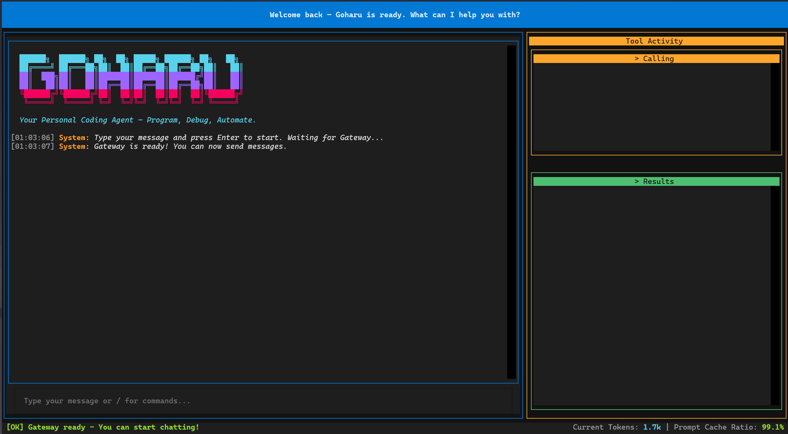

# Goharu

双智能体个人 AI 系统，运行于 Windows / Linux。前台 Hero 负责对话与执行任务，幕后 Arch 负责系统自愈、更新审计与环境探测。



## 组成

- **Hero**：主智能体。ReAct 循环（思考 → 工具 → 观察 → 回答），提供文件、命令、联网、PDF 等工具，经 QQ 机器人或终端 TUI 交互，带 L0→L3 记忆金字塔。
- **Arch**：幕后维护智能体，持有私有记忆塔。监听遥测、自愈故障、审计代码更新、探测裸机环境。两者可双向通信。

## 能力

| 能力 | 说明 |
|---|---|
| 多通道对话 | QQ（私聊 / 群@）+ TypeScript Ink TUI；消息跟随最近活跃通道，TUI 常驻旁观 |
| 记忆金字塔 | L0 原始消息 → L1 经验原子 → L2 场景 → L3 人设；FTS5 + BM25 + 向量混合检索 |
| 子智能体 | Explore / Plan / Verify（只读）；Arch 可写 |
| 自愈与自升级 | 监听卡死 / 逻辑错误 / 更新信号；GitHub 更新经 staging 审计与四态确认后合并 |
| 裸机部署 | 首次启动探测 12 类系统信息，缺项由 Arch 补漏 |
| Checkpoint | turn 级文件 + 记忆双捕获，可回退 |
| 组网 | HaruNet：多实例广播互联 |
| 安全链 | 命令三态（允许 / 确认 / 硬拒）、先 Read 后 Edit、shell 写拦截 |

## 安装

一条命令进入交互式引导：选模型厂商、填密钥、装依赖、写配置，完成后即可启动。

Windows（PowerShell）：

```powershell
powershell -ExecutionPolicy Bypass -Command "irm https://raw.githubusercontent.com/AoYuharu/Goharu/master/bootstrap.ps1 | iex"
```

Linux / macOS：

```bash
bash -c "$(curl -fsSL https://raw.githubusercontent.com/AoYuharu/Goharu/master/bootstrap.sh)"
```

要求 git、Python ≥ 3.10、Node.js ≥ 18；缺失时引导程序会给出对应系统的安装命令。

安装会注册全局命令 `goharu`：完成后新开一个终端，在任意目录输入 `goharu` 即启动。

已克隆仓库则运行 `./install.sh`（Windows 用 `install.bat`），等价进入引导。

卸载：`./uninstall.sh [--all|--purge]`（Windows 用 `uninstall.bat`）。

## 配置

全部由 `config.yaml` 驱动，默认值即可运行。支持任一 Anthropic 兼容端点（DeepSeek / MiniMax / Kimi / GLM / 官方）。

| 区块 | 控制内容 |
|---|---|
| `model` | LLM 端点 / 模型 / 重试，多模型历史切换 |
| `memory` | 记忆金字塔与检索参数 |
| `tools` | 工具链、安全名单、MCP servers（`${ENV_VAR}` 引用密钥） |
| `agent` | ReAct 深度、看门狗、上下文压缩阶梯 |
| `architect_hub` | Arch 的遥测 / 唤醒 / 更新门控 / Bootstrap |
| `sessions` | 多会话与通道挂载（TUI / QQBot / 遥测） |

## 架构

QQ / TUI 等通道插件 → Gateway（会话装配、路由、压缩阶梯）→ Hero（ActorAgent ReAct 引擎）→ Tools / Memory / Prompting / Agent 四个解耦子系统（facade 接入）；Arch 独立监听遥测与更新。

## 开发

各子系统（`Tools/` `Memory/` `Prompting/` `Agent/` `Architect/`）有独立维护文档 `CLAUDE.md` 与契约测试 `tests/test_*_standalone.py`，改动公共接口后须跑对应测试。详见根目录 `CLAUDE.md`。

---

**English.** Goharu is a dual-agent personal AI system for Windows/Linux. Hero is the conversational ReAct agent (QQ bot / terminal TUI, file & shell tools, L0→L3 memory pyramid). Arch is a backstage maintainer with a private memory tower: telemetry watch, self-healing, staged update audit, bare-metal probing. Install in one line via `bootstrap.sh` / `bootstrap.ps1`; the installer registers a global `goharu` command so you can launch from anywhere. Any Anthropic-compatible endpoint works. Configuration lives in `config.yaml`.
